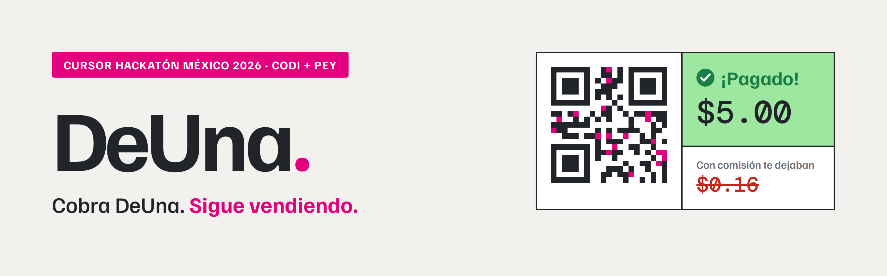

# DeUna: cobros con CoDi y sin comisión para el comercio informal

DeUna permite cobrar desde el celular con CoDi: el dinero llega directo a la cuenta bancaria del comercio, sin comisión por cobro. Está [en vivo](https://deuna.cattion.com) en modo de prueba; mientras se cargan las llaves de pey, el botón «Simular pago» permite recorrer el flujo completo.

## El encuentro

**Fecha:** sábado 14 de noviembre de 2026, desde las 11:00 a. m.  
**Sede:** UTOPÍA Elena Poniatowska Amor, Av. Miguel Hidalgo 128, San Lucas, Coyoacán, 04100, Ciudad de México.  
**Organizan:** SpaceXAI Ambassadors, AI Builders México y pey.  
**Página:** [Cursor Hackatón México](https://luma.com/event/evt-2jFHOvlKkFzm1S1).

El encuentro en la Ciudad de México abre presencialmente el Hackatón Nacional México, dedicado a crear experiencias de pagos digitales. El 14 de noviembre hay kickoffs en las ciudades participantes; después siguen cuatro semanas de construcción en línea, individual o en equipo. Las entregas cierran el sábado 12 de diciembre; los resultados y proyectos destacados se anuncian el lunes 14 de diciembre.

## DeUna

«Cobra DeUna. Sigue vendiendo.» DeUna se abre en el navegador, sin descargar nada, y puede agregarse a la pantalla de inicio. La interfaz está diseñada para celular, iPad y escritorio.

1. En [Cobrar](https://deuna.cattion.com/cobrar), el vendedor escribe el monto y muestra un QR para que el cliente lo escanee con la app de su banco; también puede enviar el cobro a un número celular de 10 dígitos.
2. La pantalla de espera muestra una cuenta regresiva de seis minutos. Cuando entra el pago, cambia automáticamente a «¡Pagado!»; en modo de prueba, «Simular pago» permite ver ese resultado.
3. En [Cobros](https://deuna.cattion.com/cobros), el vendedor consulta el total del día, la cantidad de cobros y el estado de cada uno: Pagado, Esperando, Vencido o Falló.

## Contexto: el comercio popular

El comercio popular está en los tianguis, los mercados, las fondas, los puestos de tacos o tamales y los oficios que van a domicilio, como plomería o estética. Parte de esa actividad ocurre en la economía informal. Según la Encuesta Nacional de Ocupación y Empleo (ENOE) del INEGI, en el segundo trimestre de 2026 trabajaban en la informalidad 33.1 millones de personas: el 55.1 % de la **población ocupada**. La tasa mensual de septiembre fue de 54.3 %.

Dentro de ese conjunto, el INEGI llama *sector informal* al trabajo en unidades económicas no registradas, principalmente pequeños negocios o micronegocios familiares, sin obligaciones fiscales ni acceso a seguridad social. En el segundo trimestre de 2026, ese sector reunía a 18.2 millones de personas. La distinción importa para entender el tamaño del terreno: la informalidad laboral abarca más que los negocios del sector informal, aunque ambos forman parte del contexto en el que se mueve el comercio popular.

El efectivo sigue presente en las compras pequeñas: de acuerdo con la Encuesta Nacional de Inclusión Financiera (ENIF) 2024, el 85 % de las compras de menos de 500 pesos se pagan así. El equipo ha observado que, para un negocio pequeño, comenzar a cobrar con tarjeta o por medios digitales suele implicar abrir una cuenta, darse de alta y comprar o rentar una terminal; muchos permanecen en el efectivo, mientras que otros recurren a apps de cobro populares, que cobran una comisión por venta. Cuando cada peso cuenta, esa comisión se nota en la ganancia del día, especialmente en ventas chicas. La siguiente sección muestra cuánto pesa mediante una prueba real.

### Fuentes

- [INEGI, ENOE](https://www.inegi.org.mx/programas/enoe/15ymas/)
- [Crónica, datos del INEGI sobre el sector informal](https://www.cronica.com.mx/negocios/2026/08/25/entre-abril-y-junio-se-sumaron-495000-personas-a-la-informalidad-reporta-inegi/)
- [INEGI, ENIF 2024](https://www.inegi.org.mx/contenidos/saladeprensa/boletines/2025/enif/ENIF2024_CP.pdf)

## Por qué existe

El 14 de noviembre de 2026, el equipo creó un link de pago por $5 en una app de cobro popular. La comisión fue de $4.84; al vendedor le quedaron $0.16. La cifra coincide con la tarifa que la propia app publica para recibir el dinero al instante: 3.49 % más $4.00 por venta, con IVA de 16 % sobre la comisión. Aplicada a pagos en una sola exhibición, esa fórmula muestra cómo cambia el costo según el monto:

| Venta | Comisión | Porcentaje de la venta |
|---:|---:|---:|
| $5 | $4.84 | 97 % |
| $10 | $5.04 | 50 % |
| $20 | $5.45 | 27 % |
| $50 | $6.66 | 13 % |
| $100 | $8.69 | 9 % |

El costo puede crecer si se ofrecen meses sin intereses. En otra prueba del equipo, el simulador de esa misma app indicó que, con tarjeta de crédito a nueve meses sin intereses y dinero disponible al instante, habría que cobrar $126.12 para recibir $100; en ese escenario, el vendedor paga un 11.19 % adicional.

DeUna propone un cobro digital desde una página web que funciona en celular, iPad o computadora, sin terminal ni instalación. El vendedor escribe el monto y muestra un QR o envía el cobro al celular del cliente; cuando entra el dinero, la pantalla cambia sola a «¡Pagado!». También registra los cobros del día.

Para cobrar, DeUna integra [CoDi](https://expansion.mx/economia/2023/07/18/codi-deja-ahorros-en-comisiones-a-comercios), la plataforma de Banco de México sobre SPEI: el cobro no tiene comisión para vendedor ni comprador, y el dinero llega en segundos. La integración se hace mediante [pey](https://docs.pey.mx/); según su documentación, por el momento tampoco tiene costo. Cada pago llega directamente a la CLABE del vendedor: DeUna no recibe el dinero.

**Límites actuales**

- El vendedor necesita una cuenta bancaria con CoDi habilitado; muchas personas que trabajan en la informalidad no cuentan con una.
- Una cuenta nueva puede tardar hasta cinco días hábiles en activarse en pey ([documentación](https://docs.pey.mx/docs/api/register-bank-account)).
- CoDi tiene poca adopción entre compradores, aunque se puede pagar desde la app de cualquier banco que participe en CoDi.
- pey indica que su gratuidad es «por el momento».

## Estado

**Ya funciona:**

- El [inicio](https://deuna.cattion.com) muestra un comprobante real de otra app de cobro, con marca y datos personales tapados: un cobro de $5 que dejó $0.16. A su lado aparece «Con DeUna le quedan $5.00».
- El flujo ofrece QR o envío al celular, registra los cobros en Firestore y muestra la lista del día.
- El webhook de pey verifica la firma de cada solicitud.
- Catálogo en Cobrar: productos con precio, controles para sumar o restar, extras como «con queso +$5» y monto libre; el total se calcula automáticamente.
- Logo, íconos y *manifest* para instalar DeUna en el celular.
- Inicio de sesión con Google y una pestaña «Cuenta».

**Lo que sigue:**

- Cobros reales con pey. Las cuentas CLABE ya están activas ante Banxico; el siguiente paso es probar cobros de $0.01 en producción.

## Cómo está hecho

- **Aplicación:** Astro 7 en modo servidor con adaptador de Vercel, islas de Svelte 5, Tailwind v4, TypeScript estricto y pnpm. Usa Familjen Grotesk y DM Mono.
- **Infraestructura:** Firebase Auth con inicio de sesión de Google, Firestore en el plan Spark y despliegue en Vercel con HTTPS en `deuna.cattion.com`.
- **Integración:** el servidor llama a `POST /codi/qr` o `POST /codi/pn` de la [API de pey](https://docs.pey.mx). El webhook en `/api/webhooks/pey` verifica la firma con Standard Webhooks y responde `401` si no es válida.
- **Seguridad:** la llave de pey y la cuenta de servicio de Firebase permanecen en el servidor. El navegador no escribe cobros ni transacciones: lo hace el servidor mediante Admin SDK, con reglas en `firestore.rules`. Se conserva `bankAccountId` y los últimos cuatro dígitos, sin guardar la CLABE completa.
- **Estados:** rosa mexicano `#e4007c` para la marca y la acción principal; verde para Pagado, ámbar para Esperando, gris para Vencido y rojo para Falló. Cada estado incluye ícono y palabra además del color.

## Arranque

Instala las dependencias:

```bash
pnpm install
```

Crea el archivo local de variables a partir del ejemplo:

```bash
cp .env.example .env
```

Completa en `.env` `PEY_API_URL` —`https://api.dev.pey.mx` para pruebas—, `PEY_API_KEY`, `PEY_WEBHOOK_SECRET`, `PEY_BANK_ACCOUNT_ID` (opcional: la cuenta que recibe el dinero), `FIREBASE_SERVICE_ACCOUNT` y las variables `PUBLIC_FIREBASE_*`. Para probar en local sin llaves de pey, basta con `PEY_MOCK=true`, que activa el modo de prueba con «Simular pago»; sin llave y sin `PEY_MOCK`, crear un cobro responde `503`. Los secretos quedan en `.env`, ignorado por Git, y en las variables de entorno de Vercel.

Inicia el servidor local en el puerto 4400:

```bash
pnpm dev
```

Genera la versión de producción:

```bash
pnpm build
```

Ejecuta las comprobaciones del proyecto:

```bash
pnpm check
```

## Créditos

Proyecto hecho para el Cursor Hackatón México 2026 por Santiago García Arellano y Tania Belen Gayosso Dominguez. También forma parte del portafolio de Cattion, colectiva interdisciplinaria de tecnología, diseño y humanidades.

## Licencia

[GNU Affero General Public License v3.0](LICENSE) (AGPL-3.0).
